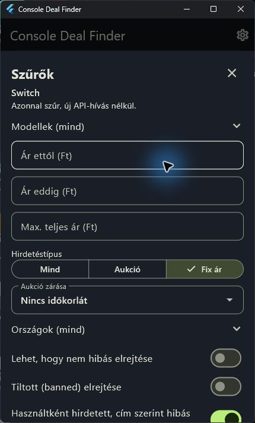

# Console Deal Finder

> **EN:** A personal Android & Windows app (Flutter) that finds faulty, for-parts consoles, controllers, Nintendo Switch, Steam Deck, iPhones and graphics cards on EU eBay sites that ship directly to Hungary. Backend: Google Apps Script + Google Sheets, using the official eBay Browse API. UI and docs are in Hungarian.

Saját használatra készült **Android- és Windows-alkalmazás**, amely EU-s eBay-oldalakon keres **hibás, alkatrésznek vagy javításra árult** készülékeket, kizárólag olyanokat, amelyek **közvetlenül Magyarországra rendelhetők**. A cél: megtalálni a megjavítható és továbbértékesíthető készülékeket, egy helyen, valós és friss adatokkal.

| Asztali nézet | Telefonos szűrők |
|---|---|
|  |  |

## Funkciók

- **Eszközcsoportok külön fülön:** PS5 és Xbox Series konzolok, DualSense és Xbox kontrollerek, Nintendo Switch (V1, V2, Lite, OLED, Switch 2), Steam Deck, iPhone 11–17, videokártyák (RTX 20–50, RX 5700–9000). Minden fül megtartja a saját találatait, amíg abban a csoportban nem indítasz új keresést.
- **Csak Magyarországra szállítható ajánlatok**, a magyarországi szállítási díjjal és teljes árral. Az ismeretlen szállítási díjú tételek külön, megtekinthető csoportba kerülnek.
- **Automatikus besorolás a cím alapján:** modell és változat, csomag, alkatrész, nem támogatott modell, harmadik féltől származó kontroller, tiltott (banned) konzol, iCloud-zárolt iPhone, „lehet, hogy nem hibás” jelölés. Minden rejtett csoport megtekinthető.
- **Szűrők** azonnal, új lekérdezés nélkül: modell, ár, teljes ár, hirdetéstípus (aukció / fix ár), zárási idő, ország, kulcsszó.
- **EUR ↔ HUF:** bármelyik árra koppintva az egész app átvált (Európai Központi Bank napi árfolyama).
- **Kedvencek, elrejtés, „ÚJ” jelölés**, szinkronizálva a telefon és a gép között.
- **Aukciófigyelés és értesítés:** ha egy figyelt aukció aznap zárul, és még a megadott határ alatt van; értesítés új, feltételeknek megfelelő találatról.
- **Hirdetésleírás** egy kattintással, fordítás a Google Fordítóval.
- **0 Ft/hó:** nincs saját szerver és nincs fizetős szolgáltatás.

## Architektúra

```
 Telefon (Flutter) ─┐                         ┌─ eBay Browse API
                    ├─► Apps Script webapp ───┤
 Gép (Flutter)     ─┘   + időzített triggerek └─ ECB-árfolyam
                              │
                       Google Sheets (állapot, értesítési sor)
```

| Rész | Technológia | Mappa |
|---|---|---|
| Kliens | Flutter (Dart), Android és Windows | [`flutter_app/`](flutter_app/README.md) |
| Háttérrendszer | Google Apps Script (V8), webapp és időzített triggerek | [`apps_script/`](apps_script/README.md) |
| Adattár | Google Sheets (a felhasználó saját táblázata) | – |
| Adatforrás | eBay Browse API (hivatalos, application token) | – |
| Prototípus (referencia) | Python FastAPI + React | [`backend/`](backend/README.md), `frontend/` |

Az eBay-kulcsok kizárólag az Apps Script projekt *Script Properties* tárában vannak. Az app csak a webapp címét és egy saját kliens-tokent ismeri, és ezeket a rendszer biztonságos tárolójában őrzi.

## Saját példány telepítése

A rendszer saját példányként futtatható: mindenki a saját eBay-kulcsával és a saját Google-fiókjában.

1. **eBay fejlesztői kulcs:** regisztrálj a [developer.ebay.com](https://developer.ebay.com/) oldalon, és hozz létre egy *Production* kulcskészletet. A *Marketplace Account Deletion* értesítések alól mentesség kérhető, mert az alkalmazás nem tárol eBay-felhasználói adatot.
2. **Apps Script háttérrendszer:** az [`apps_script/README.md`](apps_script/README.md) lépései szerint (feltöltés `clasp`-pal, Script Properties, webapp-telepítés).
3. **Flutter-app:** a [`flutter_app/README.md`](flutter_app/README.md) szerint (Windows-build, APK). Első indításkor add meg a webapp címét és a kliens-tokent.

## Fejlesztés

- A specifikáció: [`console_deal_finder_terv.md`](console_deal_finder_terv.md), benne az élesben kimért eBay-keresési stratégia.
- A kódoló agenteknek szóló szabályok: [`AGENTS.md`](AGENTS.md).
- Vizsgálatok és mérési jelentések: [`docs/`](docs/).

Tesztek:

```powershell
cd apps_script; npm ci; npm test; npm run lint
```

```powershell
cd flutter_app; flutter pub get; flutter analyze; flutter test
```

A tesztek az eBay API-t nem hívják, rögzített mintaválaszokkal dolgoznak.

## Adatkezelés és jogi megjegyzések

- Az alkalmazás kizárólag a **hivatalos eBay Browse API-t** használja, scraping nélkül. A használatra az [eBay API License Agreement](https://developer.ebay.com/develop/api-license-agreement) vonatkozik.
- **Eladói vagy más eBay-felhasználói adatot az alkalmazás nem tárol.** Csak a hirdetés adatai (azonosító, cím, ár, szállítás, hely, link) kerülnek tárolásra, a frissességi szabályok szerint.
- A tesztekben és a mérési jelentésekben szereplő hirdetéscímek nyilvános eBay-hirdetésekből származnak, eladói adat nélkül.
- A projekt nem áll kapcsolatban az eBay Inc.-vel, a Sony-val, a Microsofttal, a Nintendóval, a Valve-val, az Apple-lel, az NVIDIA-val vagy az AMD-vel. A márkanevek a tulajdonosaik védjegyei.
- Az alkalmazás csak tájékoztat. A vásárlás előtt mindig ellenőrizd a hirdetést, a szállítást és (iPhone esetén) az iCloud-zár állapotát az eladónál.
