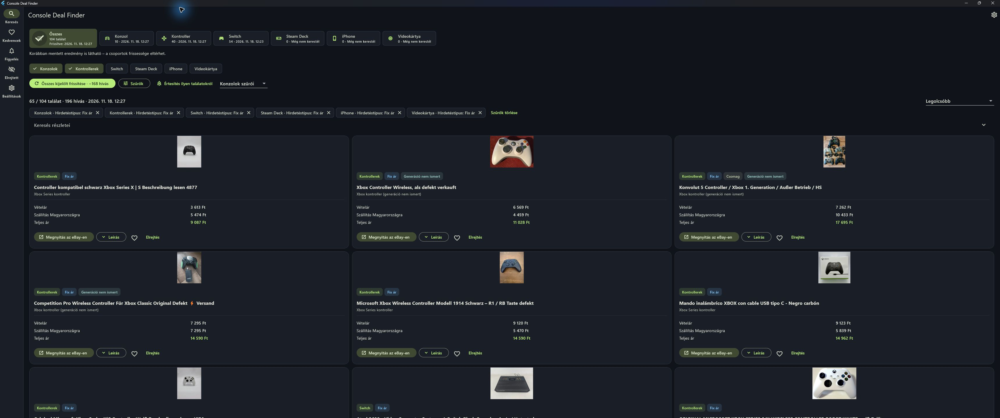

# Console Deal Finder

A personal **Android and Windows app** that searches EU eBay sites for **faulty, for-parts or repair-needed** devices, and shows only listings that **ship directly to Hungary**. The goal: find devices worth repairing and reselling, in one place, with real and fresh data.

The app's user interface and the developer documentation in the subfolders are in Hungarian.

| Desktop | Phone filters |
|---|---|
|  |  |

## Features

- **Device groups in separate tabs:** PS5 and Xbox Series consoles, DualSense and Xbox controllers, Nintendo Switch (V1, V2, Lite, OLED, Switch 2), Steam Deck, iPhone 11–17 and graphics cards (RTX 20–50, RX 5700–9000). Each tab keeps its own results until you search that group again.
- **Hungary-shippable offers only**, with the shipping cost to Hungary and the total price. Listings with an unknown shipping cost go into a separate group that you can still open.
- **Automatic title-based classification:** model and variant, bundle, spare part, unsupported model, third-party controller, banned console, iCloud-locked iPhone and a "possibly not faulty" flag. Every hidden group can be opened.
- **Instant filters** with no extra API calls: model, price, total price, listing type (auction / fixed price), time until the auction ends, country and keywords.
- **EUR ↔ HUF:** tap any price to switch the whole app between the two currencies, using the European Central Bank's daily reference rate.
- **Favourites, hidden listings and "NEW" badges**, synced between phone and desktop.
- **Auction watch and notifications:** you get an alert when a watched auction ends today and is still below your price limit, and when a new listing matches your saved rules.
- **One-tap listing description**, with translation via Google Translate.
- **No running costs:** no server of its own and no paid services.

## Architecture

```
 Phone (Flutter)   ─┐                          ┌─ eBay Browse API
                    ├─► Apps Script web app ───┤
 Desktop (Flutter) ─┘   + time-driven triggers └─ ECB exchange rate
                               │
                        Google Sheets (state, notification queue)
```

| Part | Technology | Folder |
|---|---|---|
| Client | Flutter (Dart), Android and Windows | [`flutter_app/`](flutter_app/README.md) |
| Backend | Google Apps Script (V8), web app and time-driven triggers | [`apps_script/`](apps_script/README.md) |
| Data store | Google Sheets (the user's own spreadsheet) | – |
| Data source | eBay Browse API (official API, application token) | – |
| Prototype (reference only) | Python FastAPI + React | [`backend/`](backend/README.md), `frontend/` |

The eBay credentials are stored only in the Apps Script project's *Script Properties*. The app knows only the web app URL and its own client token, and keeps both in the operating system's secure storage.

## Running your own instance

Each instance runs with its own eBay keys, in its owner's own Google account.

1. **eBay developer keys:** sign up at [developer.ebay.com](https://developer.ebay.com/) and create a *Production* keyset. You can request an exemption from *Marketplace Account Deletion* notifications, because the app does not store any eBay user data.
2. **Apps Script backend:** follow [`apps_script/README.md`](apps_script/README.md) (upload with `clasp`, set the Script Properties, deploy the web app).
3. **Flutter app:** follow [`flutter_app/README.md`](flutter_app/README.md) (Windows build, Android APK). On first launch, enter the web app URL and the client token.

## Development

- Specification, including the eBay search strategy measured on live data: [`console_deal_finder_terv.md`](console_deal_finder_terv.md)
- Rules for coding agents: [`AGENTS.md`](AGENTS.md)
- Investigations and measurement reports: [`docs/`](docs/)

To run the tests:

```powershell
cd apps_script; npm ci; npm test; npm run lint
```

```powershell
cd flutter_app; flutter pub get; flutter analyze; flutter test
```

The tests use recorded sample responses and do not call the eBay API.

## Data handling and legal notes

- The app uses only the **official eBay Browse API**, with no scraping. Its use is subject to the [eBay API License Agreement](https://developer.ebay.com/develop/api-license-agreement).
- **The app does not store seller data or any other eBay user data.** It stores only listing data (ID, title, price, shipping, location, link), within the API's freshness limits.
- Listing titles in the tests and measurement reports come from public eBay listings and contain no seller data.
- This project is not affiliated with eBay Inc., Sony, Microsoft, Nintendo, Valve, Apple, NVIDIA or AMD. All brand names are trademarks of their respective owners.
- The app is for information only. Before buying, always check the listing, the shipping terms and, for iPhones, the iCloud lock status with the seller.
